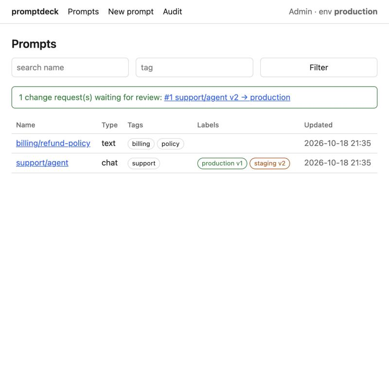
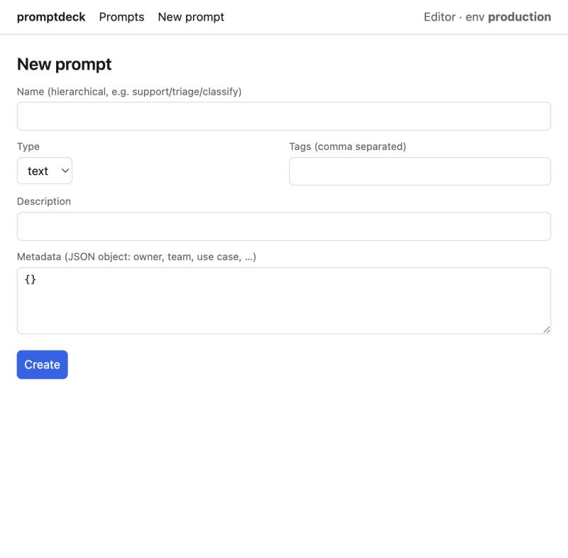
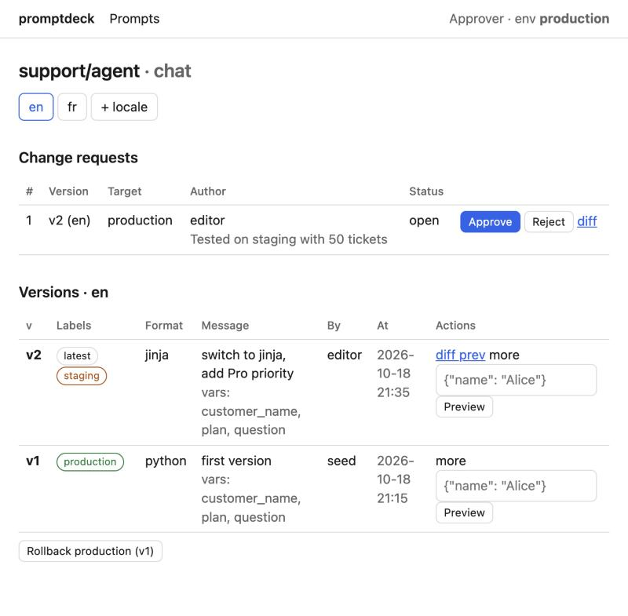
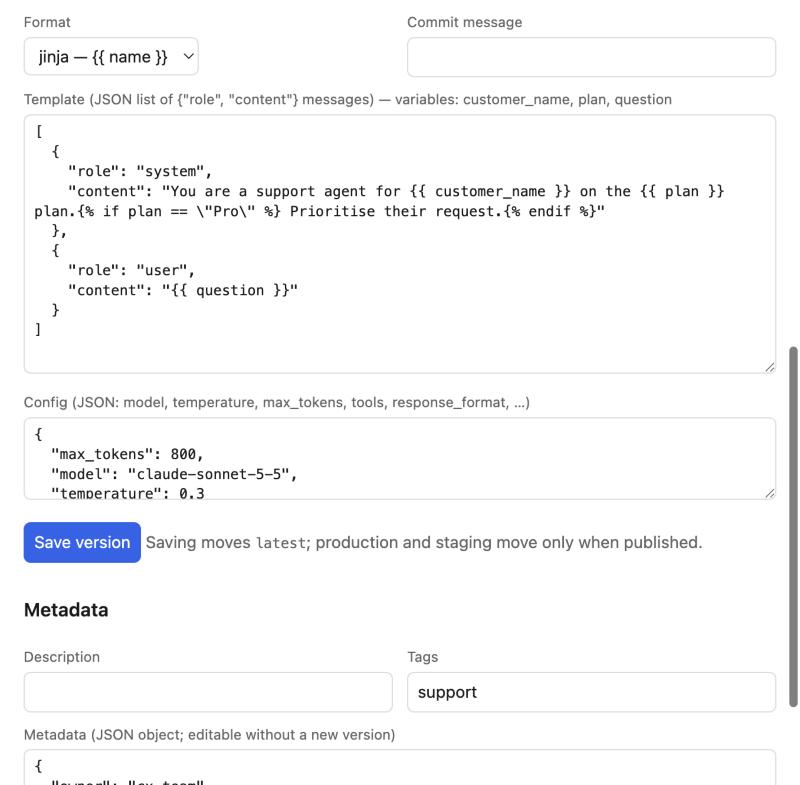
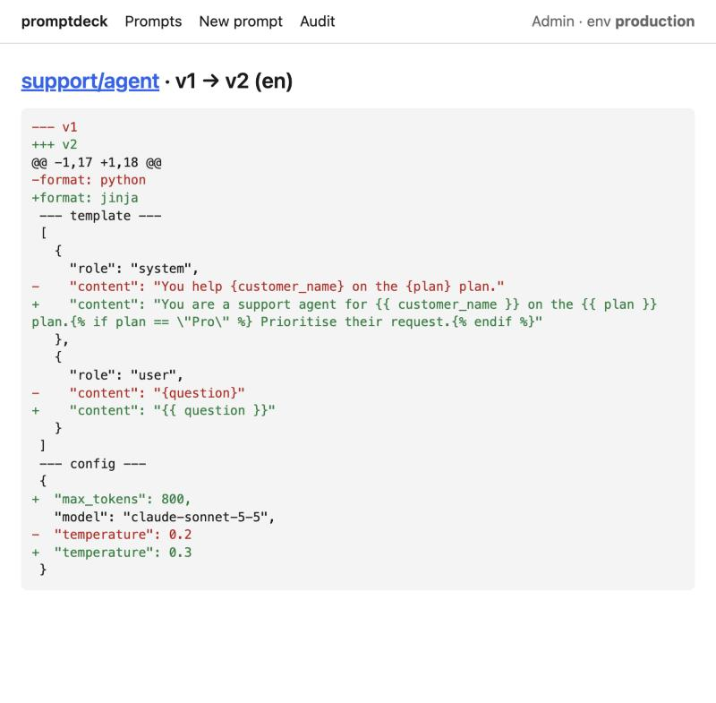
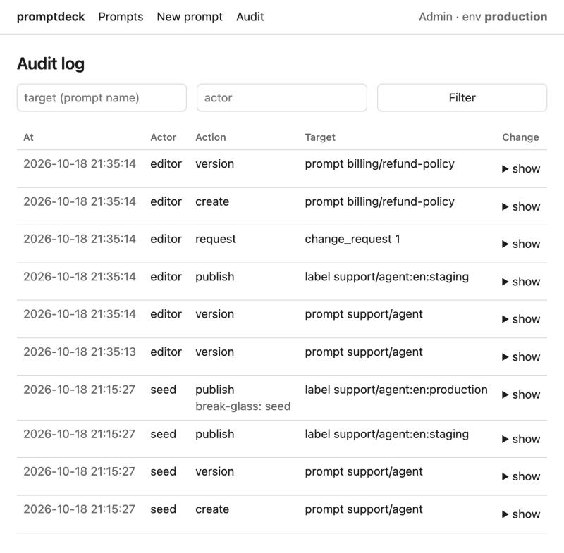

# promptpivot user guide

This guide lists every feature, how to use it from code, the admin UI and the CLI, and the
situations each one is for. The [README](../README.md) has the install and quickstart.

## 1. The model in one minute

```
prompt  "support/agent"  (type: text | chat, tags, metadata)
 └─ locale "en"                        └─ locale "fr"
     ├─ v1  v2  v3  ...  (immutable)        ├─ v1  v2 ...
     └─ labels: production → v2            └─ labels: production → v1
                staging    → v3                        latest     → v2
                latest     → v3
```

- A **prompt** is a named slot. Code always asks for a prompt by name.
- Each **locale** of a prompt has its own numbered, immutable **versions**.
- A **label** points one locale at one version. Code reads labels (`production` by default), never
  version numbers, so moving a label is how you publish and roll back.
- A **change request** is how a protected label (`production`) gets moved: one person requests,
  a different person approves, then anyone with publish rights publishes.

## 2. Roles and permissions

Your app's auth decides who the user is; promptpivot decides what they may do from the
permissions you put on the `Principal`.

| Permission | Who usually has it | What it unlocks |
| --- | --- | --- |
| `prompts:read` | everyone who can open the UI | browse, preview, diff, health |
| `prompts:edit` | prompt engineers, PMs | create prompts, save versions, edit metadata, open change requests |
| `prompts:publish:staging` | prompt engineers | move the `staging` label |
| `prompts:publish:production` | tech leads, on-call | move the `production` label (publish and roll back) |
| `prompts:approve` | tech leads | approve or reject change requests |
| `prompts:admin` | a few owners | everything, plus archive, audit log, break-glass publish |

Map your roles once in the dependency you pass to `admin_router`:

```python
ROLE_PERMISSIONS = {
    "editor":   {"prompts:read", "prompts:edit", "prompts:publish:staging"},
    "approver": {"prompts:read", "prompts:approve", "prompts:publish:production"},
    "admin":    {"prompts:admin"},
}

async def principal(user=Depends(get_current_user)) -> Principal:
    perms = set().union(*(ROLE_PERMISSIONS[r] for r in user.roles))
    return Principal(id=user.id, name=user.email, permissions=frozenset(perms))
```

## 3. Features

### 3.1 Prompts: names, types, tags

**What.** A prompt has a hierarchical name (`support/triage/classify`), a type (`text` renders to
a string, `chat` renders to a list of role/content messages), optional description and tags.

**Code**
```python
prompts.create_prompt("support/agent", "chat", actor="ann", tags=["support"], description="Tier-1 agent")
prompts.list_prompts(q="support", tag="support")          # search by name substring and tag
prompts.update_prompt("support/agent", actor="ann", tags=["support", "tier1"])
prompts.archive("support/agent", actor="ann")              # hidden from lists and from get(); history kept
prompts.archive("support/agent", actor="ann", archived=False)
```

**UI.** *New prompt* in the header; the list page filters by name and tag; *Archive* / *Restore* at
the bottom of a prompt page (admin only).

**Use cases.** One prompt per step of an agent (`support/triage/classify`, `support/triage/reply`).
Tags group by team or feature. Archive retired prompts instead of deleting them so old traces
still resolve.

### 3.2 Versions and template formats

**What.** Every save creates the next version number for that locale. A version stores the
template, format, config, detected variables, commit message, author, timestamp and checksum.
Versions are never edited or deleted.

Two formats, chosen per version:

| Format | Syntax | When to use |
| --- | --- | --- |
| `python` | `Hello {name}` (`{{`/`}}` for literal braces, `{n:03d}` specs allowed) | simple substitution; safest; fastest |
| `jinja` | `Hello {{ name }} (VIP)` | conditions, loops, filters; sandboxed with strict undefined |

**Code** (rarely needed: most teams save versions in the UI)
```python
rec = prompts.create_version(
    "support/agent",
    [{"role": "system", "content": "You help {{ customer_name }}."}, {"role": "user", "content": "{{ question }}"}],
    format="jinja", message="add greeting", actor="ann", config={"model": "claude-sonnet-5-5"},
)
rec.version, rec.variables, rec.warning   # 2, ('customer_name', 'question'), None
# config=None keeps the previous version's config; pass {} to clear. Message objects or dicts both work.
prompts.history("support/agent", "en")
prompts.diff("support/agent", 1, 2)   # unified diff of format, template and config
```

**UI.** The *New version* form on a prompt page: pick the format, type the template (chat
prompts take a JSON list of messages), the detected variables update as you type, add a commit
message, *Save version*. The form is prefilled with the latest version, so editing wording keeps the
model settings. Saving moves only the `latest` label.

**Use cases.** Iterate freely: every save is reversible and attributable. Switch a prompt from
python to jinja when it needs a condition; the switch itself is versioned.

### 3.3 Config: model settings next to the prompt

**What.** Each version carries a JSON `config` (model, temperature, max_tokens, tools,
response_format, anything else). It is validated against `PromptConfig` by default, or your own
Pydantic model.

**Code**
```python
class MyConfig(BaseModel):
    model: str
    temperature: float = 0.2
    json_mode: bool = False

prompts = PromptRegistry(engine, config_model=MyConfig)     # registry-wide
acc = prompts.define("support/agent", config=MyConfig)      # or per prompt
p = acc.get()
llm.chat(model=p.config.model, temperature=p.config.temperature, ...)
```

**UI.** The *Config (JSON)* box under the template. Invalid JSON or a value that fails the model is
rejected with a message.

**Use cases.** Let a prompt engineer lower the temperature or switch the model without a deploy.
Keep tools or a JSON schema for structured output with the prompt that expects it.

### 3.4 Metadata: ownership and custom fields

**What.** Each prompt has a free-form JSON object (owner, team, use case, ticket, any key). It is
edited without creating a version, and is audited. An optional Pydantic model types it.

**Code**
```python
class Meta(BaseModel):
    owner: str
    team: str | None = None

acc = prompts.define("support/agent", metadata=Meta)
acc.get().metadata.owner
prompts.update_metadata("support/agent", {"owner": "cx", "team": "tier1"}, actor="ann")
prompts.list_prompts(metadata={"owner": "cx"})
```

**UI.** The *Metadata* form at the bottom of a prompt page (description, tags, JSON).

**Use cases.** Route alerts to the owning team; record the ticket that motivated a prompt; feed
dashboards from `trace_attributes()` plus metadata.

### 3.5 Locales

**What.** A prompt can have variants per BCP 47 tag (`en`, `fr`, `pt-BR`). Each locale has its own
versions and labels. Resolution on read: exact tag, then base language, then the default locale.

**Code**
```python
prompts.create_version("support/agent", "Bonjour {customer_name}", locale="fr", message="fr", actor="ann")
prompts.publish("support/agent", 1, "staging", locale="fr", actor="ann")
p = prompts.get("support/agent", locale="fr-CA")   # fr-CA -> fr -> en
p.locale, p.requested_locale                        # 'fr', 'fr-CA'
```

Saving a locale whose variables differ from the default locale's production version returns a
warning (shown in the UI flash), so a translation cannot silently drop a variable.

**UI.** Locale tabs under the prompt title; *+ locale* asks for a tag and opens an empty tab to
save the first version into.

**Use cases.** Serve French users a native prompt and everyone else English, with one call site.

### 3.6 Labels and environments

**What.** Built-in labels: `production`, `staging`, and `latest` (moves on every save). Custom
labels (`canary`, `experiment-b`) are allowed. The registry's `environment` setting is the label
`get()` uses when none is given, so the same code reads `staging` in staging and `production` in
production.

**Code**
```python
prompts = PromptRegistry(engine, environment=os.environ["APP_ENV"])   # "staging" or "production"
prompts.get("support/agent")                      # environment label
prompts.get("support/agent", label="canary")      # explicit label
prompts.publish("support/agent", 3, "canary", actor="ann")
prompts.labels("support/agent")                   # every label of every locale
prompts.label_history("support/agent", "production")
```

**Use cases.** Test on staging, then promote. Point a `canary` label at a new version and read it
for 5% of traffic in code. Keep a `fallback` label for a known-good version.

### 3.7 Publishing, approvals and break-glass

**What.** Publishing moves a label in one transaction with an optimistic lock. Labels in
`protected_labels` (default `production`) require an approved change request. The approver must
differ from the author (`require_distinct_approver`). Admins can bypass with `force=True` plus a
reason, which is highlighted in the audit log.

**Code**
```python
cr = prompts.request_change("support/agent", 2, "production", actor="ann", comment="tested on staging")
prompts.approve(cr.id, actor="bob")                      # bob != ann
prompts.publish("support/agent", 2, "production", actor="bob")
prompts.publish("support/agent", 2, "production", actor="ops", force=True, reason="incident 123")
prompts.publish("support/agent", 2, "staging", actor="ann", expected_current=1)   # PromptConflict if moved
```

**UI.** On a version row, open *more*: *→ staging* publishes directly; *Request production* opens a
change request; admins also see *Force production*. Open change requests appear at the top of the
prompt page and on the list page with *Approve* / *Reject* / *diff*; once approved, a *Publish*
button appears for anyone with `prompts:publish:production`.

**Use cases.** Four-eyes control on production prompts; a single-click emergency override for
on-call with an audit trail.

### 3.8 Rollback

**What.** Moves a label back to the version it pointed to before its last move. No change request
is needed because that version was already approved for the label. Recorded as `rollback` in audit.
It is an undo: rolling back twice re-applies the move. The UI button shows the destination
(`Rollback production: v3 → v2`) so there is no guessing during an incident.

**Code / CLI**
```python
prompts.rollback("support/agent", "production", actor="ops")
```
```bash
promptpivot rollback support/agent production --locale en
```

**UI.** *Rollback production (vN)* button under the versions table. The worker that handled the
click serves the old version immediately; others within `cache_ttl`.

### 3.9 Reading prompts in application code

**What.** `get()` / `aget()` return an immutable `Prompt` handle. `define()` returns a typed
accessor. `compile()` renders; `trace_attributes()` gives span attributes.

```python
p = await prompts.aget("support/agent", locale=user.locale, default="Hello {customer_name}")
p.name, p.version, p.label, p.locale, p.requested_locale, p.type, p.format
p.template            # str or list[Message]
p.config.model        # typed
p.metadata            # dict or your model
p.variables           # ('customer_name', 'plan')
p.is_fallback         # True when served from default= or a stale entry during an outage
text_or_messages = p.compile(customer_name="Alice", plan="Pro")   # str | list[Message]
text = p.compile_text(...)            # typed str; raises PromptRenderError on a chat prompt
messages = p.compile_messages(...)    # typed list[Message]; raises on a text prompt
span.set_attributes(p.trace_attributes())
```

Typed accessor, recommended for anything used from more than one place:

```python
support_agent = prompts.define("support/agent", variables=SupportVars, config=MyConfig, metadata=Meta)
p = await support_agent.aget()
messages = p.compile(SupportVars(customer_name="Alice", plan="Pro"))   # or keyword args, validated
```

`default=` is used only when the prompt is missing or the database is unreachable with nothing
cached. Give it to prompts that must never fail.

Errors to handle: `PromptNotFound`, `PromptRenderError` (missing variable, bad template),
`PromptValidationError` (variables/config/metadata fail their model), `PromptStoreUnavailable`
(database down, nothing cached, no default), `PromptConflict` (concurrent label move),
`PromptPolicyError` (approval or author/approver rule).

### 3.10 Caching and propagation

- First use loads the prompt; nothing is preloaded and startup runs no queries.
- A hit costs a dictionary lookup. A miss costs one indexed query shared by all concurrent callers.
- `cache_ttl` (default 300 s) is the maximum delay between a publish and every worker serving it.
  Pass `ttl=` per call for a hotter or colder prompt; `ttl=0` always queries.
- A publish or rollback made through a registry clears that process's entries for the prompt.
- During a database outage, expired entries keep serving for `max_stale` (1 h) with
  `is_fallback=True`, retried every 5 s, with one warning per 30 s in the `promptpivot` logger.
- `cache_max_entries` (500) bounds memory per worker.

```python
prompts.get("support/agent", ttl=5)          # near-real-time for an experiment
prompts.cache.invalidate("support/agent")    # force a reload in this process
prompts.cache.stats()                        # size, hits, misses, hit_ratio
```

### 3.11 Preview and diff

**Preview** renders any version with sample variables and no LLM call: *Preview* on a version row
(JSON of variables) or `POST api/prompts/{name}/preview`. **Diff** compares format, template and
config between two versions: *diff prev* on a version row, *diff* on a change request (current
production vs the proposed version), or `GET api/prompts/{name}/diff?a=1&b=2`.

### 3.12 Audit log

Every create, version, metadata change, label move, rollback, request, approval, rejection and
archive is an append-only record with actor, action, target, before/after values and reason.

```python
prompts.audit(target_id="support/agent", limit=50)
prompts.audit(actor="ops")
```

**UI.** *Audit* in the header (admin). Filter by prompt name or actor; *show* expands before/after.

### 3.13 Export, import and the CLI

```bash
export PROMPTPIVOT_DATABASE_URL=postgresql+psycopg://...
promptpivot migrate                           # create or upgrade tables (Alembic when installed)
promptpivot list
promptpivot export -o prompts.yaml            # or .json; selected names as extra args
promptpivot import prompts.yaml               # versions matched by checksum; labels set unless --no-labels
promptpivot publish support/agent 7 staging
promptpivot publish support/agent 7 production --force --reason "incident"
promptpivot rollback support/agent production
```

`prompts.export()` / `prompts.import_prompts(data)` do the same from code, and admins have an
*Import* page (paste JSON) and an *Export* download in the UI.

**Use cases.** Nightly backup; copy prompts from staging to production databases; seed a new
environment or a developer's SQLite; keep a reviewed YAML in git if you want a paper trail there.

### 3.14 Health and observability

- `GET <prefix>/api/health` returns database reachability and cache stats; `prompts.health()` in code.
- With `opentelemetry-api` installed, every `get()` adds `prompt.name`, `prompt.version`,
  `prompt.label`, `prompt.locale`, `prompt.is_fallback` to the current span automatically.

### 3.15 Security defaults

Not mounted unless you include the router; your `principal` runs on every route; CSRF
double-submit cookie on every UI form; API mutations accept only `application/json`; python
formatter allows only plain names; Jinja runs in a sandbox with strict undefined; prompt content
never leaves the server except to authorised admin users.

## 4. The admin UI, page by page

Mount at `/admin/prompts` (or any prefix). The header shows the signed-in principal and the
registry's environment. Only links the user is allowed to use are shown.

### Prompt list



Search by name substring and tag. Each row shows type, tags and the current version of every
non-`latest` label per locale (`production v1`, `staging v2`, `staging·fr v1`). Open change requests
are summarised at the top with links.

### New prompt



Name (hierarchical, letters, digits, `_ . -` and `/`), type, tags, description and metadata JSON.
After *Create* you land on the prompt page to save a first version.

### Prompt page



Top to bottom:

1. **Locale tabs** and *+ locale*.
2. **Change requests** for this prompt (open and approved) with *Approve*, *Reject*, *diff* and,
   once approved, *Publish*.
3. **Versions** for the selected locale, newest first, with labels, format, commit message,
   detected variables, author and time. *diff prev* compares with the previous version. *more*
   reveals *Preview* (enter variables as JSON), *→ staging*, *Request production* and, for admins,
   *Force staging/production* (asks for a reason).
4. **Rollback** buttons, one per label that is set for this locale.
5. **New version** form (editors): format, commit message, template with live variable detection,
   config JSON.

   

6. **Metadata** form: description, tags, metadata JSON; *Archive* / *Restore* for admins.

Every action redirects back here with a green confirmation or a red error line at the top.

### Diff



Unified diff of format, template and config. Reached from *diff prev*, from a change request, or
by URL `p/<name>/diff?a=1&b=2&locale=en`.

### Import and Export (admin)

*Export* downloads every prompt, version and label as JSON. *Import* takes that JSON pasted into a
text box: missing prompts are created, versions already present (same template, format and
config) are skipped, and labels are set when the checkbox is on. This is the quickest way to move
prompts from staging to production or to seed a fresh environment.

### Audit log



Newest first, filter by target (prompt name) or actor, *show* expands before/after and the reason.
Break-glass publishes carry a `break-glass:` reason.

## 5. Workflows

**Change a production prompt without a deploy.** Editor saves a new version → *→ staging* → test
the staging app → *Request production* → approver clicks *Approve* then *Publish* → every worker
serves it within `cache_ttl`.

**Add a language.** Open the prompt, *+ locale* `fr`, save a version, publish it to `staging` and
`production` for `fr`. Users asking for `fr-CA` get it; others keep `en`. Watch the variables
warning when saving.

**Incident: a bad prompt is live.** On-call opens the prompt, clicks *Rollback production*, or
runs `promptpivot rollback <name> production`. Confirm with the labels on the list page and the
`prompt.version` attribute on new LLM spans.

**Canary a rewrite.** Publish the new version to a `canary` label (no approval needed for custom
labels) and read it for a slice of traffic:
```python
label = "canary" if user.id % 20 == 0 else None
p = await prompts.aget("support/agent", label=label)
```

**Typed prompt inside an agent.**
```python
support_agent = prompts.define("support/agent", variables=SupportVars, config=MyConfig)

async def answer(user, question):
    p = await support_agent.aget(locale=user.locale, default=[{"role": "user", "content": "{question}"}])
    messages = p.compile(SupportVars(customer_name=user.name, plan=user.plan, question=question))
    with tracer.start_as_current_span("llm") as span:
        span.set_attributes(p.trace_attributes())
        return await llm.chat(model=p.config.model, temperature=p.config.temperature, messages=messages)
```

**Sync code (Celery task, script, sync FastAPI route).** Use the sync forms: `prompts.get()`,
`prompts.publish()`. With an `AsyncEngine` these work from worker threads and scripts; inside a
coroutine use the `a`-prefixed forms.

**Move prompts from code into the database.** Paste each prompt into *New prompt* and *New
version*, or write one export JSON and use *Import*. Replace the Python constant with
`prompts.get("name", default=OLD_CONSTANT)` and drop the default once the database path is trusted.

**First local run with no auth yet.** `admin_router(prompts, principal=dev_principal)` with
`PROMPTPIVOT_DEV_UI=1` in the environment gives an all-permissions user; the dependency refuses to
run without that variable.

**Seed a new environment.** `promptpivot export -o prompts.yaml` on the source database,
`promptpivot import prompts.yaml` on the target. Labels are set as in the file; use `--no-labels` to
import versions only and publish by hand.

**Grant a PM edit rights without production access.** Give them `prompts:read`, `prompts:edit`,
`prompts:publish:staging`. They can iterate and request production; they cannot move it.
